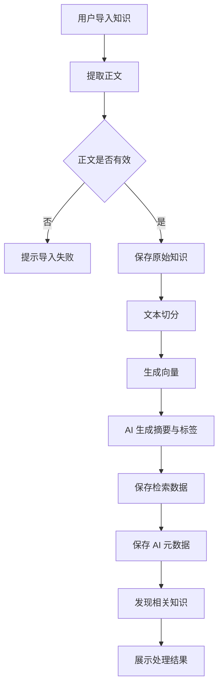
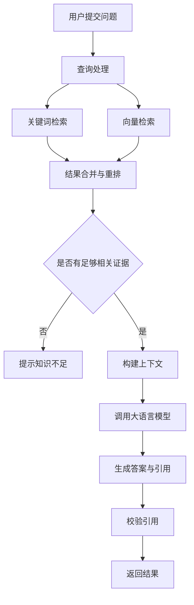
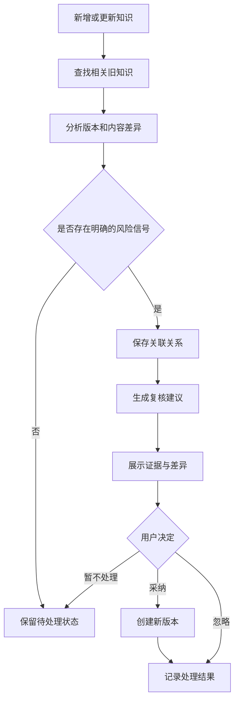
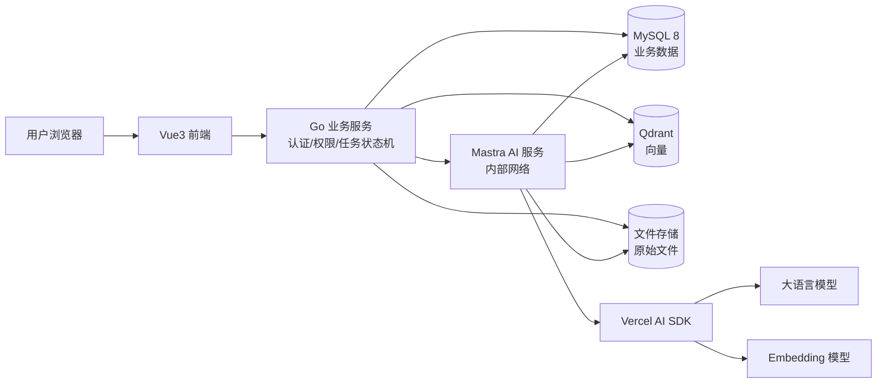
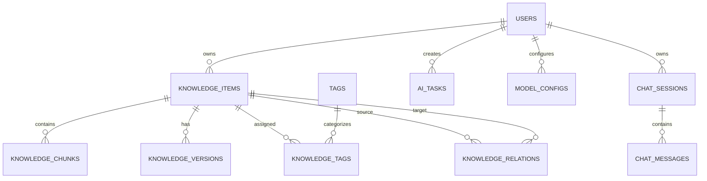

# 基于大语言模型的个人知识管理与演化系统

产品设计文档 · MVP 版本 · V1.1

> **V1.1 修订说明（技术选型对齐架构方案 v2.1）**：系统由"全新构建"改为基于 cloud-drive 全栈项目演进——业务后端为复用扩展的 Go 服务（替代 Next.js Route Handlers），数据库改为 MySQL 8 + Qdrant（替代 PostgreSQL + pgvector，关键词检索改用 ngram 全文索引），Mastra 以 `mastra serve` 独立服务模式运行；产品定位、功能需求与创新点不变。

## 一、项目概述

### 1.1 项目名称

- 中文名称：知序——基于大语言模型的个人知识管理与演化系统
- 英文名称：KnowledgeFlow

英文名称也可以在后续确定后调整，当前主要用于项目代号和仓库命名。

### 1.2 项目背景

随着互联网技术的发展，个人获取知识的渠道越来越多，包括技术文档、博客文章、电子书、网页和个人笔记。但知识分散在不同的载体中，用户往往面临以下问题：

1. **知识分散**：不同来源的知识难以统一管理，查找效率较低。
2. **整理成本高**：手动编写摘要、添加标签和归纳重点需要投入较多时间。
3. **知识缺乏关联**：不同时间、不同来源的笔记彼此孤立，难以形成完整的知识体系。
4. **检索效率低**：传统关键词搜索难以准确理解用户的问题和知识内容之间的语义关系。
5. **知识容易过时**：已保存的知识可能随着技术迭代而失去时效性，但用户很难及时发现。

因此，本项目拟结合大语言模型、向量检索、检索增强生成（RAG）等技术，构建一个具备知识采集、智能整理、语义检索、知识关联和知识演化能力的个人知识管理系统。

### 1.3 产品定位

本项目不是简单的 AI 聊天工具，也不是普通的 Markdown 笔记软件，而是一个以个人知识为核心的数据管理与智能处理系统。

核心理念：

> 用户负责积累知识，系统负责理解知识、建立关联、辅助检索，并帮助用户持续维护知识。

### 1.4 目标用户

- 需要积累技术文档和学习笔记的开发者。
- 需要长期整理资料的学生和研究人员。
- 经常阅读文章、文档和电子书的知识工作者。

首期以个人技术知识管理为主要使用场景，避免一开始就扩展到团队协作、企业知识库等复杂需求。

## 二、产品目标与设计原则

### 2.1 产品目标

| 目标       | 具体实现                  |
| -------- | --------------------- |
| 统一管理   | 集中保存笔记、网页资料和文档         |
| 降低整理成本 | 自动生成摘要、标签和关键词          |
| 提高检索效率 | 关键词搜索、语义检索和 AI 问答      |
| 建立知识体系 | 自动发现相关知识并可视化           |
| 辅助知识维护 | 识别潜在过时、重复和冲突的知识        |

### 2.2 设计原则

1. **知识优先**：原始知识始终由用户掌控，AI 生成的内容不能直接覆盖原文。
2. **结果可追溯**：AI 回答应尽可能关联到具体知识条目和原文片段。
3. **自动化但可控**：AI 可以提出整理和修改建议，但重要变更应由用户确认。
4. **渐进式建设**：先实现可靠的知识采集与检索，再逐步加入知识演化功能。
5. **避免过度 Agent 化**：固定流程使用确定性代码控制，只有需要模型理解、判断或生成的环节才调用 LLM。

## 三、核心功能设计

系统采用分阶段建设的方式，将功能划分为 MVP 必需功能和后续增强功能。

### 3.1 功能模块总览

```
个人知识管理与演化系统
│
├── 1. 知识管理
│   ├── 创建与编辑笔记
│   ├── 导入 Markdown / 网页 / PDF
│   ├── 知识列表与详情
│   ├── 分块结果预览
│   └── 分类、标签与收藏
│
├── 2. AI 智能整理
│   ├── 自动生成摘要
│   ├── 自动提取关键词
│   ├── 自动推荐标签
│   └── 自动发现相关知识
│
├── 3. 智能检索
│   ├── 关键词搜索
│   ├── 语义检索
│   ├── 混合检索
│   └── AI 问答与来源引用
│
├── 4. 知识关联
│   ├── 相关知识推荐
│   ├── 知识关系管理
│   └── 知识图谱可视化
│
├── 5. 知识演化
│   ├── 重复知识检测
│   ├── 潜在过时知识识别
│   ├── 知识冲突提示
│   └── AI 修改建议与版本记录
│
└── 6. 系统管理
    ├── 用户与认证
    ├── AI 模型配置
    ├── 处理任务状态
    └── 基础使用统计
```

其中，前四个模块构成主要业务闭环，第五个模块是项目的特色方向。

### 3.2 知识管理模块

这是整个系统的数据基础。

功能要求：

| 功能            | 说明                            | MVP  |
| ------------- | ----------------------------- | ---- |
| 手动创建        | 编辑标题和正文                      | 必须  |
| Markdown 编辑   | 支持标题、列表、代码块等                | 必须  |
| 文件导入        | 导入 Markdown 和 PDF             | 必须  |
| 网页导入        | 获取网页正文并保存来源 URL             | 必须  |
| 分类与标签       | 对知识进行组织                      | 必须  |
| 收藏与归档       | 管理常用和暂不使用的知识                | 可选  |
| 分块预览        | 查看知识分块后的具体内容与处理状态         | 可选  |
| 编辑历史        | 查看知识修改记录                    | 增强  |

每一条知识至少应保存标题、正文、来源、创建时间、更新时间和处理状态。

对于 PDF 和网页，应尽量保留原始文件或来源地址，便于后续回溯。

**设计要点**：原始内容与 AI 生成的摘要、标签等元数据应分开存储。重新执行 AI 整理任务时，不应意外覆盖用户的原始内容。

**分块预览**：系统提供一个独立页面，展示每条知识经过文本切分后的实际结果，让用户能够直接看到"具体是怎么分块的"。

分块预览页面包括：

- 按分块顺序展示各分块内容、序号、字符数和元数据（如页码、标题路径）。
- 展示每个分块的向量化状态和索引状态，便于确认该分块是否参与语义检索。
- AI 问答中的引用可以跳转到分块预览页，并高亮对应分块，方便用户核对答案依据。
- 当某条知识"检索不到"或"被意外引用"时，用户可以通过该页面直接检查分块内容是否符合预期，辅助排查分块策略问题。
- 分块策略调整后，支持对单条知识重新执行分块与向量化，并展示最新的处理结果。

### 3.3 AI 智能整理模块

用户创建或导入知识后，可以触发智能整理流程。

输入一篇技术文章，系统生成：

```json
{
  "summary": "介绍 React Server Components 的基本原理与应用场景。",
  "keywords": [
    "React",
    "Server Components",
    "服务端渲染"
  ],
  "suggestedTags": [
    "React",
    "前端架构"
  ],
  "concepts": [
    "组件渲染",
    "服务端执行",
    "客户端组件"
  ]
}
```

以上为预期输出示例，并非要求模型必须生成完全相同的内容。

功能包括：

- 自动生成简洁摘要。
- 提取关键词和核心概念。
- 推荐已有标签，必要时提出新标签。
- 识别与当前知识可能相关的条目。
- 支持重新生成与人工修改。

**实现原则**：使用结构化输出和 Schema 校验约束模型返回的数据。标签推荐应优先复用现有标签，减少同义标签泛滥的问题。

### 3.4 智能检索与 AI 问答模块

这是系统的核心使用入口。

用户可以提出自然语言问题，例如：

> 我之前整理过哪些关于 Next.js 服务端渲染的知识？它们之间有什么联系？

系统从个人知识库中检索相关内容，再基于检索结果组织答案。

建议采用混合检索流程：

1. 对用户问题进行必要的查询改写。
2. 执行关键词检索和向量语义检索。
3. 合并并重排检索结果。
4. 选择相关知识片段作为上下文。
5. 调用大语言模型生成答案。
6. 返回答案及其引用来源。

回答界面示例：

```
问题：Server Component 与 Client Component 有什么区别？

AI 回答：
Server Component 主要在服务端执行，
Client Component 用于需要客户端交互的场景。

参考知识：
[1] Next.js App Router 学习笔记
[2] React Server Components 原理
[3] 前端渲染模式总结
```

引用必须指向真实检索到的知识，而不能由模型自行编造。对于没有足够证据支持的问题，系统应明确提示知识库中缺少相关信息。

### 3.5 知识关联与知识图谱模块

系统需要将独立的知识条目连接起来，帮助用户发现潜在关联。

关联来源分为两类：

- **自动推荐**：根据语义相似度和知识内容，推荐可能相关的条目。
- **显式关系**：根据内容分析或用户确认，建立"依赖于""补充说明""对比于"等关系。

例如：

```
React
  │
  ├── 相关概念 ── React Server Components
  │                    │
  │                    ├── 应用于 ── Next.js App Router
  │                    │
  │                    └── 涉及 ──── 服务端渲染
  │
  └── 相关概念 ── React Hooks
```

图谱页面支持：

- 查看全部知识节点。
- 点击节点打开知识详情。
- 展示与当前知识直接相关的条目。
- 查看关系类型和关联来源。
- 手动确认、删除或调整关系。

MVP 阶段不需要建设独立的图数据库。使用 MySQL 保存节点和关系即可，前端负责图形化展示。

### 3.6 知识演化模块

这是项目最值得投入设计和验证的特色功能。

它不意味着系统可以自动知道所有技术的最新状态，而是帮助用户发现知识库内部值得重新检查的内容。

建议先实现以下三个子功能。

**A. 重复知识检测**

新知识导入后，系统检索可能重复的已有条目，展示标题、相似度和内容差异，交由用户判断是否合并。

**B. 潜在过时知识识别**

例如，用户过去保存了一篇关于旧版框架 API 的笔记，而后续又导入了描述新版 API 的资料。

系统可以根据版本信息、时间信息和内容差异提示：

> 这条旧笔记可能需要复核。新导入的资料提到了不同的 API 使用方式。

需要注意，时间较早并不意味着知识已经过时。只有在检测到具体版本差异、明确冲突或其他可解释的证据时，才应提高提醒等级。

**C. 知识冲突与修订建议**

系统识别两条知识之间可能存在的矛盾，展示原文证据，并生成修改建议。

用户可以选择：

- 保留原文。
- 采纳建议并创建新版本。
- 忽略提醒。
- 标记为已核实。

整个流程必须保留原始内容和修改历史，避免模型误判导致知识丢失。

### 3.7 系统设置与任务管理

MVP 只需要实现必要的系统能力：

- 用户登录与数据隔离。
- LLM 和 Embedding 模型配置。
- 文档处理任务状态。
- 失败任务的错误提示与重试。
- 基础用量统计，例如知识条目数、导入数量和问答次数。

模型密钥应由服务端安全保存，不应直接暴露给浏览器。

## 四、典型业务流程设计

### 4.1 知识导入流程



这里建议采用异步任务模式。正文解析、向量生成和 AI 整理不必阻塞用户浏览其他页面。

如果某一步失败，应保留已经保存的原始知识，并允许重新执行失败的处理步骤。

### 4.2 AI 问答流程



为了降低错误引用的风险，检索结果应带有稳定的知识 ID 和片段 ID。生成答案时要求模型引用这些 ID，再由服务端解析成真实的知识链接。

### 4.3 知识演化流程



建议把演化检查设计为独立工作流，避免每次导入知识都执行昂贵的全库扫描。

## 五、页面与交互设计

产品采用简洁、偏 Apple 风格的界面，强调留白、清晰层级和内容阅读体验。AI 功能应融入知识操作流程，而不是让聊天窗口占据整个产品。

### 5.1 整体布局

```
┌──────────────────────────────────────────────────────┐
│ Logo / 知序              搜索知识        头像 / 设置 │
├──────────────┬───────────────────────────────────────┤
│              │                                       │
│  首页        │                                       │
│  全部知识    │             当前页面内容              │
│  分类与标签  │                                       │
│  知识图谱    │                                       │
│  AI 问答     │                                       │
│  演化中心    │                                       │
│              │                                       │
│  设置        │                                       │
└──────────────┴───────────────────────────────────────┘
```

### 5.2 核心页面

| 页面    | 主要内容                  |
| ----- | --------------------- |
| 首页    | 最近知识、待处理任务、演化提醒       |
| 知识列表  | 搜索、筛选、排序、分类与标签        |
| 知识详情  | 正文、摘要、标签、关联知识、版本      |
| 分块预览  | 分块列表、正文内容、向量与索引状态、引用高亮 |
| 导入页面  | 文件上传、网页 URL、处理进度       |
| AI 问答 | 对话、引用来源、相关知识推荐        |
| 知识图谱  | 节点、关系、筛选与详情            |
| 演化中心  | 重复项、冲突项、过时风险及处理状态    |
| 系统设置  | 模型配置、账户和系统选项           |

### 5.3 交互原则

- 主要操作应当明确，例如"导入知识""新建笔记""开始问答"。
- AI 生成内容采用预览和确认机制。
- 异步处理需要展示排队中、处理中、成功和失败等状态。
- 问答引用支持点击跳转到原知识，并可进一步定位到对应的分块。
- 图谱节点数量过多时，优先展示当前知识附近的局部关系，而不是一次性渲染全部节点。

## 六、技术选型与系统架构

### 6.1 技术栈

系统基于 cloud-drive 全栈项目演进（前端 Vue3 + TypeScript，后端 Go + Gin + GORM + MySQL），AI 能力以独立 Mastra 服务接入；优先复用已有积累，避免毕设的大量时间消耗在重写基础能力上。详细架构决策见《架构设计方案-v2.md》。

| 层次      | 技术选型                                       | 用途              |
| ------- | ------------------------------------------ | --------------- |
| 前端      | Vue 3 + TypeScript + Vite + Pinia + Tailwind CSS（复用 cloud-drive 前端） | 页面和交互           |
| 业务后端    | Go + Gin + GORM（复用 cloud-drive 后端，扩展 AI 任务/检索/会话模块）     | API、鉴权、任务状态机、业务编排 |
| AI 工作流  | Mastra（`mastra serve` 独立服务模式，Node.js 20 + TypeScript）   | AI 整理、问答和演化工作流  |
| 模型调用    | Vercel AI SDK                              | 模型接入、结构化输出与流式输出 |
| 业务数据库   | MySQL 8（ngram 全文索引，替代原 pg_jieba 方案）              | 知识、关系、用户、任务、会话  |
| 向量检索    | Qdrant                                     | 语义检索            |
| 文件存储    | 本地磁盘（Docker 卷，复用 cloud-drive 存储层）                  | PDF 等原始文件       |
| 认证      | JWT + bcrypt（复用 cloud-drive 认证体系）                    | 登录与会话           |
| 部署      | Docker Compose + Nginx                     | 部署与反向代理         |

这里有一个重要的架构决定：Mastra 和 Vercel AI SDK 不需要承担相同的职责。

可以把 Mastra 用于组织具有多个步骤的 AI 工作流，把 AI SDK 用于模型调用、结构化输出和前端流式交互。具体使用哪些能力，应以实际 SDK 版本提供的接口为准。

### 6.2 系统架构



架构说明：

- 前端负责知识管理、搜索、问答和图谱展示。
- Go 业务服务是唯一对外网关与状态属主：认证、数据校验、权限控制、任务状态机、会话持久化、引用校验。
- Mastra AI 服务仅内部可达（共享密钥鉴权），负责多步骤 AI 任务的组织（解析、分块、向量化、整理/问答/关联/演化），本身无状态。
- MySQL 8 存储业务数据（ngram 全文索引支持关键词检索）；Qdrant 存储向量与检索 payload，由 AI 服务独占写入。
- 文件存储与数据库分离，避免把大型原始文件直接塞进业务表；AI 服务通过共享卷读取原始文件。
- 大型文档处理采用异步任务（`ai_tasks` 表 + 轮询），任务状态由 Go 统一管理。

### 6.3 为什么是双服务架构，而不是单体或微服务？

对于个人毕设，"Go 业务服务 + Mastra AI 计算服务"两个服务是合理的上限。拆分依据是职责差异：鉴权、权限、任务状态、会话持久化必须收敛在单一属主（Go）；而文档解析、向量化、LLM 编排是纯粹的计算负载，交给 Mastra 独立服务模式，可直接复用其 Studio 调试与可观测性能力。

这不是微服务化：AI 服务不暴露公网端口、不持有业务状态、不解析 JWT，仅通过带共享密钥的内部 API 与 Go 通信，也不引入消息队列等额外基础设施。AI 服务整体不可用时，基础文件功能零影响，语义检索可降级为关键词检索。

## 七、数据库设计

建议先设计 9 张核心表，全部落在 MySQL 8（向量由 Qdrant 单独存储，见 `knowledge_chunks` 表说明）。表结构是逻辑设计，字段类型和约束以开发阶段产出的 MySQL 物理 DDL 为准。

### 7.1 ER 关系概览



### 7.2 核心表结构

#### `users`：用户表

| 字段            | 类型             | 说明             |
| ------------- | -------------- | -------------- |
| id            | CHAR(36)       | 主键（UUID）        |
| email         | VARCHAR(255)   | 登录邮箱，唯一索引     |
| password_hash | VARCHAR / NULL | 密码哈希（bcrypt）   |
| created_at    | DATETIME(3)    | 创建时间           |

#### `knowledge_items`：知识主表

| 字段          | 类型          | 说明                          |
| ----------- | ----------- | --------------------------- |
| id          | CHAR(36)    | 主键（UUID）                    |
| user_id     | CHAR(36)    | 所属用户                        |
| title       | VARCHAR(512) | 标题                          |
| content     | LONGTEXT    | 原始正文                        |
| summary     | TEXT        | AI 摘要                       |
| source_type | VARCHAR(32) | manual、markdown、pdf、web    |
| source_url  | TEXT / NULL | 原始来源地址                     |
| status      | VARCHAR(32) | active、archived 等           |
| created_at  | DATETIME(3) | 创建时间                        |
| updated_at  | DATETIME(3) | 更新时间                        |

#### `knowledge_chunks`：知识分块表

| 字段           | 类型        | 说明            |
| ------------ | --------- | ------------- |
| id           | CHAR(36)  | 分块 ID（由 Go 发放） |
| knowledge_id | CHAR(36)  | 所属知识          |
| content      | TEXT      | 分块文本，建 ngram 全文索引 |
| chunk_index  | INT       | 块序号           |
| metadata     | JSON      | 页码、标题路径等元数据   |

**向量不存本表**：Embedding 由 AI 服务写入 Qdrant（payload 含 `chunk_id` / `knowledge_id` / `user_id`），向量维度与实际选用的 Embedding 模型一致，不能提前随意固定；更换模型需全库重建（见 SRS 2.5）。

#### `tags`：标签表

| 字段         | 类型          | 说明    |
| ---------- | ----------- | ----- |
| id         | CHAR(36)    | 主键    |
| user_id    | CHAR(36)    | 所属用户  |
| name       | VARCHAR(128) | 标签名称，同用户内唯一（不区分大小写） |
| created_at | DATETIME(3) | 创建时间  |

#### `knowledge_tags`：知识与标签关联表

| 字段           | 类型        | 说明            |
| ------------ | --------- | ------------- |
| knowledge_id | CHAR(36)  | 知识 ID         |
| tag_id       | CHAR(36)  | 标签 ID         |
| source       | VARCHAR(16) | manual 或 ai   |

通过独立关联表支持一条知识拥有多个标签，同时记录标签来自人工还是 AI 推荐。

#### `knowledge_relations`：知识关系表

| 字段            | 类型          | 说明                              |
| ------------- | ----------- | ------------------------------- |
| id            | CHAR(36)    | 主键                              |
| source_id     | CHAR(36)    | 起始知识                            |
| target_id     | CHAR(36)    | 目标知识                            |
| relation_type | VARCHAR(32) | 关系类型                            |
| confidence    | FLOAT       | 关联置信度                           |
| evidence      | JSON        | 关联依据                            |
| status        | VARCHAR(16) | suggested、confirmed、rejected   |

建议为关系表增加唯一约束，避免相同方向、相同类型的关系重复插入。

#### `knowledge_versions`：知识版本表

| 字段             | 类型          | 说明            |
| -------------- | ----------- | ------------- |
| id             | CHAR(36)    | 主键            |
| knowledge_id   | CHAR(36)    | 知识 ID         |
| version_number | INT         | 版本号           |
| title          | VARCHAR(512) | 标题快照          |
| content        | LONGTEXT    | 正文快照          |
| change_source  | VARCHAR(16) | manual 或 ai   |
| created_at     | DATETIME(3) | 创建时间          |

#### `ai_tasks`：AI 任务表

| 字段            | 类型                 | 说明                                |
| ------------- | ------------------ | --------------------------------- |
| id            | CHAR(36)           | 主键（Go 发放）                         |
| user_id       | CHAR(36)           | 用户 ID                             |
| knowledge_id  | CHAR(36) / NULL    | 关联知识                              |
| task_type     | VARCHAR(32)        | ingest、summarize、evolve 等         |
| status        | VARCHAR(16)        | pending、running、success、failed    |
| error_message | TEXT / NULL        | 面向用户可读的错误信息                     |
| created_at    | DATETIME(3)        | 创建时间                              |
| finished_at   | DATETIME(3) / NULL | 完成时间                              |

此外，还需要两张表：聊天会话与消息表（保存问答会话、用户问题、模型回答和引用信息，实现问答模块时补充）；`model_configs` 模型配置表（provider、base_url、加密存储的 API Key、chat/embedding 模型名称、embedding 维度等，对应 FR-SYS-03）。

数据库设计注意事项：

- 所有用户可访问的业务数据都应实施用户级权限校验。
- 向量检索必须同时限制用户范围，防止跨用户检索。
- 引用信息需要记录知识 ID 和分块 ID，不能只保存模型生成的文本链接。
- 版本表应在采纳修改之前保存旧版本，而不是修改之后才尝试恢复。

## 八、核心 AI Workflow 设计

本项目不需要让所有业务都由 Agent 自主决策。推荐采用确定性工作流作为主干，必要时再让模型参与判断。

### 8.1 知识整理工作流

```
输入知识
   ↓
提取正文
   ↓
文本清洗与校验
   ↓
┌────────────────────────┐
│ 并行处理                │
│                        │
│ A. 生成摘要与关键词     │
│ B. 文本分块与向量化     │
└────────────────────────┘
   ↓
保存处理结果
   ↓
检索相关知识
   ↓
生成关联建议
   ↓
更新任务状态
```

其中，文本清洗、分块和数据写入主要使用确定性代码；摘要和关联判断等任务才需要调用模型。

### 8.2 知识演化工作流

建议使用以下步骤：

1. 根据新知识检索候选旧知识。
2. 根据语义相似度、版本信息等条件筛选候选项。
3. 让模型比较具体内容，而不是仅凭两条知识的相似度判断冲突。
4. 生成包含旧内容、新内容、差异描述和证据的结构化结果。
5. 将结果写入待审核列表。
6. 根据用户操作更新关系、版本和处理状态。

例如，模型可以输出：

```json
{
  "type": "potential_conflict",
  "reason": "两条笔记对同一 API 的参数要求存在差异。",
  "evidence": [
    {
      "knowledgeId": "existing-knowledge-id",
      "quote": "旧笔记中的相关原文"
    },
    {
      "knowledgeId": "new-knowledge-id",
      "quote": "新笔记中的相关原文"
    }
  ],
  "suggestedAction": "review"
}
```

这只是输出结构示例。真正的业务代码需要验证知识 ID、引用内容和权限，并对无法确认的情况进行降级处理。

### 8.3 错误处理

AI 工作流应当考虑：

- 模型调用超时。
- 返回内容不符合 Schema。
- Embedding 生成失败。
- 数据库写入失败。
- 同一任务被重复执行。
- 用户在任务执行期间删除或修改了原始知识。

建议通过任务状态、重试策略、幂等操作和日志记录处理这些情况，而不是只依赖模型重试。

## 九、毕设创新点与可验证性

这里需要区分"产品特色"和"学术创新"。

仅仅把大模型、RAG 和知识图谱组合起来，不足以自动证明存在研究创新。建议把创新点写成可以实现、可以测量、可以对比的技术方案。

### 9.1 创新点一：基于混合检索的个人知识问答

结合关键词检索和向量语义检索，提升用户自然语言问题与个人知识内容之间的匹配能力。

可验证指标：

- Recall@K：前 K 个结果的召回率。
- MRR：首个相关结果的排名表现。
- 答案引用准确率。
- 无相关知识时的拒答表现。

对比实验可以设置关键词检索、纯向量检索和混合检索三组方案。

### 9.2 创新点二：结合语义相似度与关系证据的知识关联

不仅依据向量相似度建立关联，还通过知识内容分析识别关联类型，并允许用户确认。

可验证指标：

- Top-K 相关知识推荐准确率。
- 关系分类准确率。
- 人工确认率。
- 无关关系比例。

### 9.3 创新点三：面向个人知识的演化辅助机制

结合候选知识检索、内容差异分析、版本信息和人工审核，发现重复、冲突或可能过时的知识。

可验证指标：

- 重复知识识别 Precision、Recall 和 F1。
- 冲突提示准确率。
- 误报率。
- 用户采纳建议的比例。

建议提前准备一组经过人工标注的测试知识，而不是仅凭几个演示案例判断效果。

## 十、开发计划与优先级

如果毕设周期有限，建议按以下顺序开发。

| 阶段      | 开发内容                       | 交付结果         |
| ------- | -------------------------- | ------------ |
| 第 1 阶段 | 需求、架构、数据库设计                | 需求文档和 ER 图   |
| 第 2 阶段 | 登录、知识 CRUD、Markdown 编辑     | 基础知识管理系统     |
| 第 3 阶段 | 文件导入、文本解析、向量化              | 可检索的知识库      |
| 第 4 阶段 | 混合检索、RAG 问答、引用             | 完整问答闭环       |
| 第 5 阶段 | AI 摘要、标签、关联推荐              | 智能整理功能       |
| 第 6 阶段 | 知识图谱、重复检测、演化审核            | 项目特色功能       |
| 第 7 阶段 | 测试、性能优化、实验数据              | 可验证的技术成果     |
| 第 8 阶段 | 论文、演示和答辩材料                | 最终毕设交付       |

建议先保证知识管理、检索和问答形成稳定闭环，再投入时间做知识图谱和演化能力。若进度紧张，演化模块优先完成重复检测与版本管理，再尝试冲突识别。

## 十一、论文目录建议

论文题目暂定：

《基于大语言模型的个人知识管理与演化系统设计与实现》

可以按以下结构组织。

### 第一章 绪论

1. 研究背景与意义
2. 国内外研究现状
3. 研究内容
4. 论文组织结构

### 第二章 相关技术与理论基础

1. 大语言模型
2. 向量嵌入与语义检索
3. 检索增强生成技术
4. 知识图谱与关系建模
5. 工作流编排技术

### 第三章 系统需求分析

1. 用户需求分析
2. 系统功能需求
3. 非功能需求
4. 系统用例分析
5. 可行性分析

### 第四章 系统总体设计

1. 系统架构设计
2. 功能模块设计
3. 数据库设计
4. AI 工作流设计
5. 安全与权限设计

### 第五章 系统详细设计与实现

1. 知识采集与文档处理
2. AI 智能整理
3. 混合检索与智能问答
4. 知识关联与图谱可视化
5. 知识演化与版本管理
6. 系统任务调度与异常处理

### 第六章 系统测试与实验分析

1. 功能测试
2. 性能测试
3. 检索效果对比实验
4. 知识关联效果评估
5. 知识演化识别效果评估
6. 实验结果与不足

### 第七章 总结与展望

1. 工作总结
2. 当前不足
3. 后续改进方向

最终目录应根据学校的论文规范、导师要求和实际完成的功能进行调整。

## 十二、MVP 范围最终建议

为了避免项目越做越大，建议把首版范围固定下来。

### 必须完成

- 用户登录与数据隔离
- Markdown 知识创建、编辑和管理
- PDF、Markdown、网页知识导入
- AI 摘要与标签生成
- 关键词与向量混合检索
- 带知识来源引用的 AI 问答
- 相关知识推荐
- 基础任务状态与异常处理

### 重点特色

- 知识图谱可视化
- 重复知识检测
- 知识版本管理
- 冲突或过时风险提示
- 人工审核与修订建议

### 暂不开发

- 多人协作与组织管理
- 复杂的可视化工作流编辑器
- 自动修改所有旧知识
- 独立微服务集群
- 多 Agent 自主协作系统
- 复杂的外部知识爬取与自动更新

## 十三、最终建议

这个项目的关键不在于集成多少 AI 技术，而在于把知识采集、整理、检索、关联和维护做成一个真正可靠的闭环。

我建议你最终将项目的技术重点集中在三个方面：

1. **混合检索与可追溯问答**：解决用户如何从大量个人知识中找到可信答案的问题。
2. **自动知识关联**：解决独立笔记之间缺乏联系的问题。
3. **知识演化辅助**：解决长期积累的知识重复、冲突和可能过时的问题。

其中，第一项保证产品可用，第二项提升产品体验，第三项形成具有辨识度的毕设特色。

下一步最值得做的事情是把这份产品设计转成一份更具体的需求规格说明书（SRS），明确每个功能的输入、输出、业务规则、异常情况和验收标准。这样你后面无论使用 Codex、Mastra 还是其他 AI 编程工具开发，都有清晰且稳定的实现依据。
